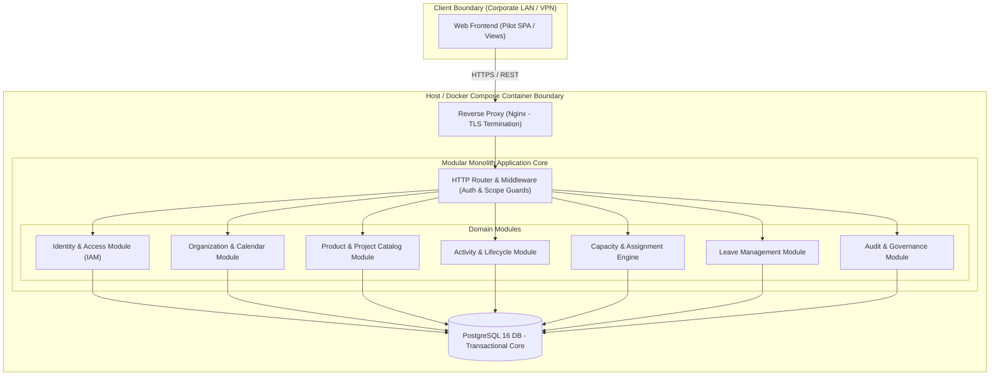
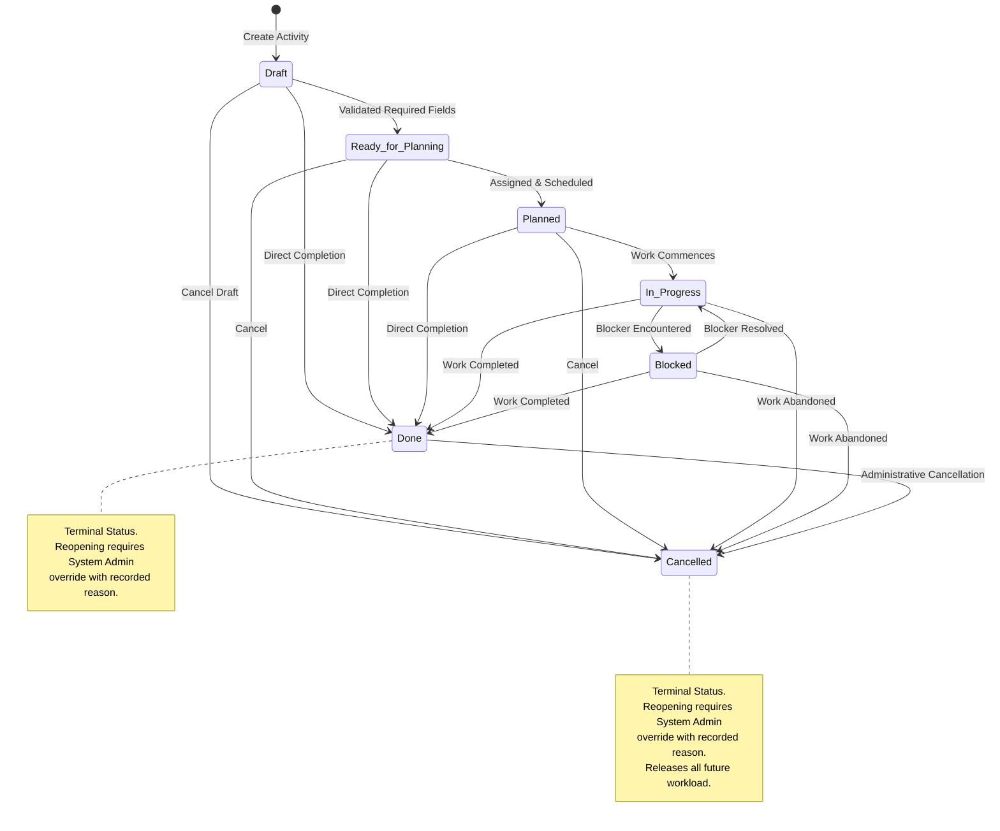
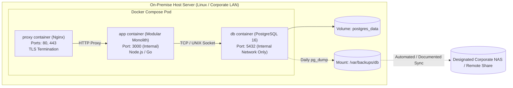

# Automotive Project & Resource Management System
## System Architecture Specification — MVP Core Pilot

**Document Version:** 1.0
**Status:** Approved Technical Design
**Authoritative Sources:** PRD.md v1.0, docs/MVP-SCOPE.md, docs/CORE-PILOT-DECISIONS.md, docs/NEXT-DECISIONS-FOR-VIVEK.md

---

## 1. Executive Summary & Architecture Goals

The Automotive Project and Resource Management System is a self-hosted, modular-monolith web application engineered for automotive engineering environments. The primary goal of the **MVP Core Pilot** is to provide an integrated, authoritative source of truth for planning project activities, assigning shared engineering resources, enforcing capacity limits, integrating approved leave, and preventing cross-project resource overloads.

### Core Architectural Principles
1. **Single Source of Truth:** A single transactional record for activities and assignments drives all project-centric views, cross-project workload views, team capacity heatmaps, and audit reports.
2. **Modular Monolith Architecture:** In-process domain modularity with clean service interfaces. This provides strict boundary isolation and domain purity without the operational overhead, network latency, and distributed transaction complexity of microservices.
3. **On-Premise Private Operation:** Packaged for single-server deployment via Docker Compose, isolated within corporate LAN and VPN boundaries with zero public internet exposure.
4. **Deterministic Capacity & Scheduling:** Capacity and utilization calculations are deterministic, time-zone consistent (`Asia/Kolkata`), calendar-aware, and aggregate across all active pilot projects.
5. **Strict Governance & Traceability:** Immutable audit logging, role- and scope-based authorization, and mandatory written justifications for material project shifts.

---

## 2. Delivery Level Boundaries & Scope Demarcation

In compliance with project governance, all architectural components are categorized into three delivery tiers:

* **Level 1: MVP Core Pilot (Current Focus):**
  * Product catalog entity seeded with "EMS ECU Development" (CPD-001).
  * Project catalog with multi-select Work-Area Tags (CPD-001).
  * 40h standard organization working calendar (Mon–Fri, 8h/day, `Asia/Kolkata`) with leave deductions (CPD-003, CPD-006).
  * Activities (max 1 sub-activity level) with non-linear status workflow (CPD-007).
  * Individual assignments in hours, cross-project load aggregation, 90% soft warning, and 100% hard block with PM/Admin override (CPD-002, CPD-004, CPD-005).
  * Five pilot roles with scoped permissions and leave privacy masking (CPD-006, CPD-008).
  * Immutable audit logging for terminal overrides, capacity overrides, and leave workflow (CPD-004, CPD-006, CPD-007; material-change threshold rules deferred per CPD-009).
  * Docker Compose on-premise single-server deployment with separate backup procedure (CPD-010).

* **Level 2: Approved Future-Compatible Architecture Concepts (Deferred Appendix in Data Model):**
  * Data structures for Finish-to-Start dependency linkages (`activity_dependencies`) and predecessor cancellation review (`predecessor_review_status`) are specified in a dedicated Deferred Appendix and excluded from the Core Pilot physical schema.
  * Placeholders for portfolio grouping and custom project lifecycle template keys.

* **Level 3: Deferred MVP Operational Hardening & Post-MVP:**
  * Active automated dependency-scheduling engine (FR-SCH-002, FR-SCH-005).
  * Interactive Gantt chart with dependency rendering and baseline variance (FR-DAS-005).
  * Corporate SSO (OIDC/LDAP/Active Directory) integration (deferred to Release 2; local auth used for pilot).
  * Multiple assignees per activity and effort-split profiles (FR-CAP-002; physical schema excluded in Core Pilot).
  * Project baselines and skill-matching structures (physical schema excluded in Core Pilot).
  * Automated WAL archiving with formal RTO 8h / RPO 4h commit (NFR-AV-001).
  * Advanced cross-portfolio analytics, skill-matching engine, and CSV/Excel bulk import wizards.

---

## 3. Modular Monolith Architecture

The application is structured as a modular monolith running in a single process. Communication across module boundaries occurs through strictly defined in-process TypeScript/Go interfaces (Domain Services), and cross-module transactions execute within standard database ACID transactions.

### 3.1 Domain Module Responsibilities

1. **Identity & Access Module (`iam`):**
   * Manages user credentials, Argon2id adaptive password hashing, and active HTTP sessions.
   * Enforces Role-Based Access Control (RBAC) across the 5 pilot roles: `System Admin`, `Project Manager`, `Team Lead`, `Team Member`, `Resource Manager` (CPD-008).
   * Enforces Scope-Based Access Control (SBAC): restricts Project Managers to assigned projects and Team Leads to assigned team members.

2. **Organization & Calendar Module (`organization`):**
   * Manages teams, member profiles, skill catalogue metadata, and baseline capacity settings.
   * Manages the authoritative working calendar: default 8 hours/day, Monday–Friday, `Asia/Kolkata` time zone (CPD-003).
   * Holds public holiday tables and per-member calendar exceptions.

3. **Product & Project Catalog Module (`project_catalog`):**
   * Manages Product entities (seeded with "EMS ECU Development", CPD-001). Product creation restricted to System Admin.
   * Manages Projects (mandatory link to exactly one Product; BR-001).
   * Manages the 14 configurable multi-select Project Work-Area Tags via an explicit many-to-many junction table.
   * Manages optional Phases/Workstreams within projects.

4. **Activity & Lifecycle Module (`activity`):**
   * Manages activities and sub-activities (enforcing maximum depth = 2: Activity → Sub-activity; CPD-007).
   * Generates stable readable human IDs (e.g., `PROJ-1042`).
   * Enforces the non-linear status state machine.
   * Executes the atomic cancellation cascade: releases future assigned load and preserves audit history (BR-008).

5. **Capacity & Assignment Engine (`capacity_scheduling`):**
   * Calculates member net weekly capacity: `(Working Days * 8) - Approved Leave - Exceptions - Buffer` (CPD-004).
   * Distributes assignment effort evenly across working days in hours (CPD-002).
   * Enforces mandatory cross-project aggregation across all active (non-archived, non-cancelled) pilot projects (CPD-005).
   * Evaluates utilization thresholds: raises 90% soft warning; enforces 100% hard block unless overridden by System Admin or assigned Project Manager with written justification (CPD-004, CPD-008).

6. **Leave Management Module (`leave`):**
   * Records member leave requests.
   * Enforces capacity impact: only `APPROVED` leave reduces capacity; `PENDING` leave creates soft warning on overlapping assignments (CPD-006).
   * Enforces server-side privacy masking: sanitizes leave reasons and types depending on caller role (CPD-006).
   * Enforces approval chains: Team Lead approves for team; Resource Manager in scope; System Admin for all.

7. **Audit & Governance Module (`audit`):**
   * Appends immutable audit records for state changes and administrative actions.
   * Enforces mandatory justification (>= 10 characters) for terminal administrative overrides (CPD-007) and capacity hard-block overrides (CPD-004). Detailed material-change threshold rules (date shift >= 3 days, estimate change >= 20%, ordinary-edit mandatory reasons) are deferred to Operational Hardening (CPD-009).

---

## 4. Status State Machine & Workflow Specification

The activity status workflow is **non-linear**. `Done` and `Cancelled` are terminal states reachable directly from any active status. `Blocked ⇄ In Progress` is an explicit, bidirectional reversible transition that does not require administrative privileges.

### 4.1 State Transition Diagram

### 4.2 Explicit Transition Matrix

| From State | Allowed To States | Authorization Rule | Reason Required? |
|---|---|---|---|
| **Draft** | `Ready for Planning`, `Cancelled`, `Done` | Project Manager, System Admin | Only if `Done` or `Cancelled` |
| **Ready for Planning** | `Planned`, `Cancelled`, `Done` | Project Manager, System Admin | Only if `Done` or `Cancelled` |
| **Planned** | `In Progress`, `Cancelled`, `Done` | Project Manager, Team Lead, System Admin | Only if `Done` or `Cancelled` |
| **In Progress** | `Blocked`, `Done`, `Cancelled` | Assignee, Team Lead, PM, Admin | If `Done` or `Cancelled` (min 10 chars) |
| **Blocked** | `In Progress`, `Done`, `Cancelled` | Assignee, Team Lead, PM, Admin | If `Done` or `Cancelled` (min 10 chars) |
| **Done** | `Cancelled`, `In Progress` (Reopen) | `Done → Cancelled`: PM, Admin. `Reopen`: **System Admin ONLY**. | **Always required** (min 10 chars) |
| **Cancelled** | `Draft`, `Planned`, `In Progress` (Reopen) | `Reopen`: **System Admin ONLY**. | **Always required** (min 10 chars) |

---

## 5. Deployment Topology & Container Architecture

The system is deployed on a dedicated on-premise application server using **Docker Compose**.

### Container Specifications
1. **`proxy` Container:**
   * Nginx reverse proxy listening on 80 (redirects to 443) and 443 (HTTPS).
   * Terminates TLS using internal corporate-CA or trusted self-signed certificates.
   * Enforces security response headers (HSTS, CSP, X-Frame-Options, X-Content-Type-Options).
   * Proxies static assets and API requests (`/api/*`) to the application container.
   * Provides maintenance mode capability via static HTML toggle.

2. **`app` Container:**
   * Runs the application backend runtime in an unprivileged container.
   * Connects to PostgreSQL over internal Docker bridge network (port 5432 is not exposed to host network).
   * Exposes HTTP `/health` liveness probe.

3. **`db` Container:**
   * PostgreSQL 16 official image tuned for transactional workload.
   * Data persisted on host Docker volume `postgres_data`.
   * Enforces strict connection limits and SSL connections where feasible.

---

## 6. PRD & CPD Traceability Matrix

| Architectural Decision | Document Reference | Approved CPD / PRD Anchor | Notes |
|---|---|---|---|
| Modular Monolith Pattern | ARCH § 3 | PRD § Architecture, NFR-MNT-001 | High maintainability, zero microservice network latency |
| Product Entity (Configurable) | ARCH § 3.1 | CPD-001, BR-001, FR-PP-001 | Seeded with EMS ECU Development; extensible for future products |
| 14 Multi-Select Project Tags | ARCH § 3.1 | CPD-001 | Junction table model, shared core project schema |
| Mandatory Hours Unit | ARCH § 3.1 | CPD-002, FR-ACT-005, FR-CAP-004 | Canonical unit; story points notes only |
| Asia/Kolkata Calendar | ARCH § 3.1 | CPD-003, BR-014, FR-RES-002 | 8h/day, Mon–Fri, time-zone consistent calculation |
| 90% Warning / 100% Hard Block | ARCH § 3.1 | CPD-004, FR-CAP-006, FR-CAP-007 | PM/Admin override with recorded reason |
| Cross-Project Aggregation | ARCH § 3.1 | CPD-005, FR-RES-010 | Joins across all active projects (not Archived/Cancelled) |
| Leave Capacity & Privacy | ARCH § 3.1 | CPD-006, FR-RES-004, PRD Security | Approved leave deducts; role-based server-side field masking |
| Non-Linear Status Workflow | ARCH § 4 | CPD-007, FR-ACT-004, BR-008 | Terminal states reachable from any active state; admin reopen |
| Five Pilot Roles | ARCH § 3.1 | CPD-008, PRD Permissions Matrix | Scoped permissions; multi-role support |
| Material Change Reason Rules | ARCH § 3.1 | CPD-009, BR-011, PRD Audit | Deferred to Operational Hardening; overrides require reason in Core Pilot |
| LAN/VPN & Local Auth Deployment | ARCH § 5 | CPD-010, Architecture Deployment | Docker Compose single server; pg_dump off-server backup |

---

## 7. Out of Scope / Deferred Items (MVP Operational Hardening & Post-MVP)

The following capabilities are explicitly deferred from the Core Pilot architecture:
* **Material-Change Threshold Rules & Interceptors:** (CPD-009 deferred to Operational Hardening; date shifts >= 3 days, estimate changes >= 20%, and ordinary-edit reason prompts excluded from Core Pilot).
* **Active Dependency Scheduling Engine:** Automatic push of downstream activities upon predecessor movement (deferred to Operational Hardening; schema compatibility reserved).
* **Predecessor Cancellation Active Review UI:** Automated dependency risk flag engine (deferred to Operational Hardening).
* **Corporate SSO / Active Directory / OIDC:** (Deferred to Release 2; local authentication approved for pilot).
* **Interactive Gantt Chart & Critical Path Engine:** (FR-DAS-005, FR-SCH-003 deferred to Operational Hardening and Release 1.1).
* **Multiple Assignees per Activity:** (FR-CAP-002 deferred to Operational Hardening; single individual assignee in pilot).
* **WAL Continuous Archiving / Point-in-Time Recovery:** (Deferred to Operational Hardening; daily off-server pg_dump in pilot).
