# Automotive Project & Resource Management System
## Database Data Model & Schema Specification — MVP Core Pilot

**Document Version:** 1.1
**Status:** **Approved Technical Design by Product Owner (Vivek, 2026-10-10)**
**Authoritative Sources:** PRD.md v1.0, docs/MVP-SCOPE.md, docs/CORE-PILOT-DECISIONS.md, docs/ARCHITECTURE.md

---

## 1. Overview & Data Integrity Principles

The Core Pilot data model is implemented on **PostgreSQL 16**. Data integrity and business rules are enforced at the database layer through strict constraints, compound foreign keys, and atomic transactions.

### Key Approved Data Architecture Rules
1. **Single Authoritative Record:** A single transactional record in `activities` and `assignments` serves all operational views (Gantt, workload heatmap, team view, dashboard rollups).
2. **One Active Assignee per Activity:** Core Pilot supports exactly one active individual assignee per activity (`UNIQUE (activity_id) WHERE status = 'ACTIVE'`). Historical assignments (`COMPLETED`, `CANCELLED`) are preserved for auditing and effort tracking. Multiple concurrent assignees are deferred to Operational Hardening.
3. **Project-Scoped Identifiers:** Activity codes are sequence-backed and unique per project (`UNIQUE (project_id, code)`). Once assigned, codes are never recycled or reused after deletion or archival.
4. **Hierarchical Project Integrity:**
   * An activity’s phase (if populated) must belong to the exact same project as the activity.
   * A sub-activity must belong to the exact same project as its parent activity.
   * Maximum sub-activity nesting depth is exactly 1 level (Activity → Sub-activity; depth ≤ 2).
5. **Phase Deletion Protection:** Phases referenced by activities cannot be hard-deleted (`ON DELETE RESTRICT`). They are retired using `phases.is_active = FALSE`.
6. **Calendar-Derived Capacity (No Stored Capacity):** Members do not store a static `weekly_capacity_hours`. Base capacity is calculated dynamically from `calendar_settings` (8 hours/day, Monday–Friday), reduced by `public_holidays`, `leave_records` (`APPROVED` only), and `member_calendar_exceptions`, then adjusted by `members.non_project_buffer_percent`.
7. **Cross-Project Load Aggregation:** Capacity queries aggregate across all active pilot projects (`status NOT IN ('ARCHIVED', 'CANCELLED')`) to prevent silent cross-project overbooking.
8. **Immutability & Retention:** Application database credentials grant only `INSERT` and `SELECT` on `audit_log`. No ordinary UI or user endpoint can update or delete audit records.
9. **Deferred Schema Exclusions:** The Finish-to-Start dependency engine (`activity_dependencies`, `predecessor_review_status`), multiple-assignee allocation structures, project baselines, and skill-matching structures are strictly excluded from the Core Pilot physical schema and exist only in the separate Deferred / Operational Hardening Appendix.

---

## 2. Core Pilot Physical Schema ERD

```mermaid
erDiagram
    PRODUCTS ||--o{ PROJECTS : "contains (1:N)"
    PROJECTS ||--o{ PHASES : "divides_into (1:N)"
    PROJECTS ||--o{ ACTIVITIES : "tracks (1:N)"
    PROJECTS ||--o{ PROJECT_WORK_AREA_TAGS : "tagged_with (1:N)"
    WORK_AREA_TAGS ||--o{ PROJECT_WORK_AREA_TAGS : "categorized_by (1:N)"
    PHASES ||--o{ ACTIVITIES : "groups (1:N, same project, ON DELETE RESTRICT)"

    ACTIVITIES ||--o{ ACTIVITIES : "parent_of (1:N self-ref, same project, max depth 2)"
    ACTIVITIES ||--o{ ASSIGNMENTS : "allocated_to (1:N history, max 1 active)"

    TEAMS ||--o{ MEMBERS : "comprises (1:N)"
    MEMBERS ||--o{ USERS : "linked_user (1:1 optional)"
    MEMBERS ||--o{ ASSIGNMENTS : "assigned_to (1:N)"
    MEMBERS ||--o{ LEAVE_RECORDS : "takes_leave (1:N)"
    MEMBERS ||--o{ MEMBER_CALENDAR_EXCEPTIONS : "has_exception (1:N)"

    USERS ||--o{ USER_ROLES : "granted (1:N)"
    ROLES ||--o{ USER_ROLES : "role_definition (1:N)"
    USERS ||--o{ USER_SCOPES : "scoped_to (1:N)"

    ACTIVITIES ||--o{ AUDIT_LOG : "audited_in (1:N)"
    ASSIGNMENTS ||--o{ AUDIT_LOG : "audited_in (1:N)"
    ASSIGNMENTS ||--o{ CONFLICT_OVERRIDES : "overridden_by (1:N)"
    CALENDAR_SETTINGS ||--o{ CALENDAR_WORKING_DAYS : "defines_working_days (1:N)"
    CALENDAR_SETTINGS ||--o{ PUBLIC_HOLIDAYS : "defines_holidays (1:N)"

    PRODUCTS {
        uuid id PK
        varchar code UK "e.g. PROD-EMS-ECU"
        varchar name "e.g. EMS ECU Development"
        varchar product_type "e.g. EMS ECU"
        uuid owner_id FK "REFERENCES members(id)"
        varchar status "ACTIVE / ARCHIVED"
        int business_priority "1 to 5"
        timestamptz created_at
        timestamptz updated_at
    }

    PROJECTS {
        uuid id PK
        uuid product_id FK "REFERENCES products(id)"
        varchar code UK "e.g. PRJ-EMS-GEN3"
        varchar name
        varchar description
        uuid project_manager_id FK "REFERENCES members(id)"
        varchar status "DRAFT / ACTIVE / ARCHIVED / CANCELLED"
        date planned_start_date
        date planned_finish_date
        timestamptz created_at
        timestamptz updated_at
    }

    WORK_AREA_TAGS {
        uuid id PK
        varchar name UK "14 Configurable Tags"
        boolean is_active
        timestamptz created_at
    }

    PROJECT_WORK_AREA_TAGS {
        uuid project_id PK, FK "REFERENCES projects(id)"
        uuid tag_id PK, FK "REFERENCES work_area_tags(id)"
    }

    PHASES {
        uuid id PK
        uuid project_id FK "REFERENCES projects(id)"
        varchar name
        int sequence_order
        boolean is_active "DEFAULT TRUE"
        date planned_start_date
        date planned_finish_date
    }

    ACTIVITIES {
        uuid id PK
        uuid project_id FK "REFERENCES projects(id)"
        uuid phase_id FK "REFERENCES phases(id) [Same Project]"
        uuid parent_activity_id FK "REFERENCES activities(id) [Same Project, Max Depth 2]"
        varchar code "Project-scoped e.g. ACT-101"
        varchar title
        varchar activity_type
        varchar priority "LOW / MEDIUM / HIGH / CRITICAL"
        uuid owner_id FK "REFERENCES members(id)"
        decimal original_estimate_hours "DECIMAL(8,2)"
        decimal current_estimate_hours "DECIMAL(8,2)"
        decimal remaining_effort_hours "DECIMAL(8,2)"
        decimal actual_effort_hours "DECIMAL(8,2) - Optional"
        date start_date
        date due_date
        varchar status "DRAFT / READY_FOR_PLANNING / PLANNED / IN_PROGRESS / BLOCKED / DONE / CANCELLED"
        timestamptz created_at
        timestamptz updated_at
    }

    ASSIGNMENTS {
        uuid id PK
        uuid activity_id FK "REFERENCES activities(id)"
        uuid member_id FK "REFERENCES members(id)"
        date start_date
        date end_date
        decimal planned_hours "DECIMAL(8,2)"
        varchar status "ACTIVE / COMPLETED / CANCELLED"
        timestamptz created_at
        timestamptz updated_at
    }

    CONFLICT_OVERRIDES {
        uuid id PK
        uuid assignment_id FK "REFERENCES assignments(id)"
        uuid overridden_by_user_id FK "REFERENCES users(id)"
        varchar override_role "SYSTEM_ADMIN / PROJECT_MANAGER"
        decimal utilization_percent_at_override "DECIMAL(6,2)"
        text justification_reason "Min 10 chars"
        timestamptz created_at
    }

    TEAMS {
        uuid id PK
        varchar code UK
        varchar name
        uuid team_lead_member_id FK "REFERENCES members(id)"
        timestamptz created_at
    }

    MEMBERS {
        uuid id PK
        uuid team_id FK "REFERENCES teams(id)"
        uuid user_id FK "REFERENCES users(id)"
        varchar employee_id UK
        varchar first_name
        varchar last_name
        varchar email UK
        decimal non_project_buffer_percent "Default 0.00 (0% to 100%)"
        boolean is_active
        timestamptz created_at
    }

    LEAVE_RECORDS {
        uuid id PK
        uuid member_id FK "REFERENCES members(id)"
        date start_date
        date end_date
        varchar leave_type "ANNUAL / SICK / PERSONAL / MATERNITY / OTHER"
        text leave_reason "Masked on API"
        varchar status "PENDING / APPROVED / REJECTED / CANCELLED"
        uuid approved_by_user_id FK "REFERENCES users(id)"
        timestamptz decided_at
        timestamptz created_at
    }

    CALENDAR_SETTINGS {
        uuid id PK
        varchar org_timezone "Asia/Kolkata"
        decimal standard_hours_per_day "Default 8.00"
        timestamptz updated_at
    }

    CALENDAR_WORKING_DAYS {
        uuid id PK
        uuid calendar_settings_id FK "REFERENCES calendar_settings(id)"
        int iso_day_of_week "1 = Monday ... 7 = Sunday"
        varchar day_name "Monday through Sunday"
        boolean is_working_day "TRUE for Mon-Fri, FALSE for Sat-Sun"
    }

    PUBLIC_HOLIDAYS {
        uuid id PK
        date holiday_date UK
        varchar name
        timestamptz created_at
    }

    MEMBER_CALENDAR_EXCEPTIONS {
        uuid id PK
        uuid member_id FK "REFERENCES members(id)"
        date exception_date
        varchar reason
        timestamptz created_at
    }

    USERS {
        uuid id PK
        varchar email UK
        varchar password_hash "Argon2id"
        varchar full_name
        boolean is_active
        boolean must_change_password
        int failed_login_attempts
        timestamptz lockout_until
        timestamptz created_at
    }

    ROLES {
        varchar role_code PK "SYSTEM_ADMIN / PROJECT_MANAGER / TEAM_LEAD / TEAM_MEMBER / RESOURCE_MANAGER"
        varchar name
        text description
    }

    USER_ROLES {
        uuid user_id PK, FK "REFERENCES users(id)"
        varchar role_code PK, FK "REFERENCES roles(role_code)"
    }

    USER_SCOPES {
        uuid id PK
        uuid user_id FK "REFERENCES users(id)"
        varchar scope_type "PROJECT / TEAM"
        uuid target_id
    }

    AUDIT_LOG {
        uuid id PK
        uuid correlation_id
        varchar entity_name
        uuid entity_id
        varchar action "INSERT / UPDATE / DELETE / STATUS_CHANGE / OVERRIDE"
        uuid actor_id FK "REFERENCES users(id)"
        jsonb before_state
        jsonb after_state
        text change_reason
        timestamptz recorded_at
    }
```



---

## 3. Database Table Definitions & Constraints

### 3.1 Catalog & Projects (CPD-001, BR-001)

#### `products` Table
```sql
CREATE TABLE products (
    id UUID PRIMARY KEY DEFAULT gen_random_uuid(),
    code VARCHAR(50) NOT NULL,
    name VARCHAR(150) NOT NULL,
    product_type VARCHAR(50) NOT NULL DEFAULT 'EMS ECU',
    owner_id UUID REFERENCES members(id) ON DELETE SET NULL,
    status VARCHAR(20) NOT NULL DEFAULT 'ACTIVE',
    business_priority INT NOT NULL DEFAULT 1,
    created_at TIMESTAMPTZ NOT NULL DEFAULT CURRENT_TIMESTAMP,
    updated_at TIMESTAMPTZ NOT NULL DEFAULT CURRENT_TIMESTAMP,
    CONSTRAINT uq_products_code UNIQUE (code),
    CONSTRAINT chk_products_status CHECK (status IN ('ACTIVE', 'ARCHIVED')),
    CONSTRAINT chk_products_priority CHECK (business_priority BETWEEN 1 AND 5)
);
```

#### `projects` Table
```sql
CREATE TABLE projects (
    id UUID PRIMARY KEY DEFAULT gen_random_uuid(),
    product_id UUID NOT NULL REFERENCES products(id) ON DELETE RESTRICT,
    code VARCHAR(50) NOT NULL,
    name VARCHAR(150) NOT NULL,
    description TEXT,
    project_manager_id UUID NOT NULL REFERENCES members(id) ON DELETE RESTRICT,
    status VARCHAR(20) NOT NULL DEFAULT 'ACTIVE',
    planned_start_date DATE NOT NULL,
    planned_finish_date DATE NOT NULL,
    created_at TIMESTAMPTZ NOT NULL DEFAULT CURRENT_TIMESTAMP,
    updated_at TIMESTAMPTZ NOT NULL DEFAULT CURRENT_TIMESTAMP,
    CONSTRAINT uq_projects_code UNIQUE (code),
    CONSTRAINT chk_projects_status CHECK (status IN ('DRAFT', 'ACTIVE', 'ARCHIVED', 'CANCELLED')),
    CONSTRAINT chk_projects_dates CHECK (planned_finish_date >= planned_start_date)
);
```

#### `work_area_tags` & `project_work_area_tags` Junction Table
```sql
CREATE TABLE work_area_tags (
    id UUID PRIMARY KEY DEFAULT gen_random_uuid(),
    name VARCHAR(100) NOT NULL,
    is_active BOOLEAN NOT NULL DEFAULT TRUE,
    created_at TIMESTAMPTZ NOT NULL DEFAULT CURRENT_TIMESTAMP,
    CONSTRAINT uq_work_area_tags_name UNIQUE (name)
);

CREATE TABLE project_work_area_tags (
    project_id UUID NOT NULL REFERENCES projects(id) ON DELETE CASCADE,
    tag_id UUID NOT NULL REFERENCES work_area_tags(id) ON DELETE RESTRICT,
    PRIMARY KEY (project_id, tag_id)
);
```

#### `phases` Table
```sql
CREATE TABLE phases (
    id UUID PRIMARY KEY DEFAULT gen_random_uuid(),
    project_id UUID NOT NULL REFERENCES projects(id) ON DELETE CASCADE,
    name VARCHAR(100) NOT NULL,
    sequence_order INT NOT NULL DEFAULT 1,
    is_active BOOLEAN NOT NULL DEFAULT TRUE,
    planned_start_date DATE,
    planned_finish_date DATE,
    CONSTRAINT uq_phases_project_id_id UNIQUE (project_id, id),
    CONSTRAINT chk_phases_dates CHECK (planned_finish_date IS NULL OR planned_start_date IS NULL OR planned_finish_date >= planned_start_date)
);
```

---

### 3.2 Activity Management (CPD-007, BR-002, BR-004)

#### `activities` Table
```sql
CREATE TABLE activities (
    id UUID PRIMARY KEY DEFAULT gen_random_uuid(),
    project_id UUID NOT NULL REFERENCES projects(id) ON DELETE RESTRICT,
    phase_id UUID,
    parent_activity_id UUID,
    code VARCHAR(50) NOT NULL,
    title VARCHAR(255) NOT NULL,
    activity_type VARCHAR(50) NOT NULL DEFAULT 'Engineering Task',
    priority VARCHAR(20) NOT NULL DEFAULT 'MEDIUM',
    owner_id UUID NOT NULL REFERENCES members(id) ON DELETE RESTRICT,
    original_estimate_hours DECIMAL(8,2) NOT NULL DEFAULT 0.00,
    current_estimate_hours DECIMAL(8,2) NOT NULL DEFAULT 0.00,
    remaining_effort_hours DECIMAL(8,2) NOT NULL DEFAULT 0.00,
    actual_effort_hours DECIMAL(8,2) NOT NULL DEFAULT 0.00,
    start_date DATE NOT NULL,
    due_date DATE NOT NULL,
    status VARCHAR(30) NOT NULL DEFAULT 'DRAFT',
    created_at TIMESTAMPTZ NOT NULL DEFAULT CURRENT_TIMESTAMP,
    updated_at TIMESTAMPTZ NOT NULL DEFAULT CURRENT_TIMESTAMP,

    -- Compound unique key for self-referential sub-activity project check
    CONSTRAINT uq_activities_project_id_id UNIQUE (project_id, id),
    -- Human-readable code unique within project; never recycled
    CONSTRAINT uq_activities_project_code UNIQUE (project_id, code),

    -- Compound foreign key: Phase must belong to the exact same project
    CONSTRAINT fk_activities_phase_same_project
        FOREIGN KEY (project_id, phase_id)
        REFERENCES phases (project_id, id)
        ON DELETE RESTRICT
        ON UPDATE CASCADE,

    -- Compound foreign key: Parent activity must belong to the exact same project
    CONSTRAINT fk_activities_parent_same_project
        FOREIGN KEY (project_id, parent_activity_id)
        REFERENCES activities (project_id, id)
        ON DELETE RESTRICT
        ON UPDATE CASCADE,

    CONSTRAINT chk_activities_priority CHECK (priority IN ('LOW', 'MEDIUM', 'HIGH', 'CRITICAL')),
    CONSTRAINT chk_activities_status CHECK (status IN ('DRAFT', 'READY_FOR_PLANNING', 'PLANNED', 'IN_PROGRESS', 'BLOCKED', 'DONE', 'CANCELLED')),
    CONSTRAINT chk_activities_estimates CHECK (
        original_estimate_hours >= 0 AND
        current_estimate_hours >= 0 AND
        remaining_effort_hours >= 0 AND
        actual_effort_hours >= 0
    ),
    CONSTRAINT chk_activities_dates CHECK (due_date >= start_date)
);

-- Sub-activity nesting depth trigger (max 1 level: Activity -> Sub-activity)
CREATE OR REPLACE FUNCTION trg_check_subactivity_depth()
RETURNS TRIGGER AS $$
BEGIN
    IF NEW.parent_activity_id IS NOT NULL THEN
        IF EXISTS (
            SELECT 1 FROM activities
            WHERE id = NEW.parent_activity_id AND parent_activity_id IS NOT NULL
        ) THEN
            RAISE EXCEPTION 'Sub-activity nesting depth cannot exceed 1 level (Activity -> Sub-activity)';
        END IF;
    END IF;
    RETURN NEW;
END;
$$ LANGUAGE plpgsql;

CREATE TRIGGER trg_activities_depth_check
BEFORE INSERT OR UPDATE OF parent_activity_id ON activities
FOR EACH ROW EXECUTE FUNCTION trg_check_subactivity_depth();
```

---

### 3.3 Resource Assignment & Overload Protection (CPD-002, CPD-004, CPD-005)

#### `assignments` Table
```sql
CREATE TABLE assignments (
    id UUID PRIMARY KEY DEFAULT gen_random_uuid(),
    activity_id UUID NOT NULL REFERENCES activities(id) ON DELETE CASCADE,
    member_id UUID NOT NULL REFERENCES members(id) ON DELETE RESTRICT,
    start_date DATE NOT NULL,
    end_date DATE NOT NULL,
    planned_hours DECIMAL(8,2) NOT NULL,
    status VARCHAR(20) NOT NULL DEFAULT 'ACTIVE',
    created_at TIMESTAMPTZ NOT NULL DEFAULT CURRENT_TIMESTAMP,
    updated_at TIMESTAMPTZ NOT NULL DEFAULT CURRENT_TIMESTAMP,
    CONSTRAINT chk_assignments_dates CHECK (end_date >= start_date),
    CONSTRAINT chk_assignments_hours CHECK (planned_hours > 0),
    CONSTRAINT chk_assignments_status CHECK (status IN ('ACTIVE', 'COMPLETED', 'CANCELLED'))
);

-- Exactly one confirmed active assignee per activity; preserves historical assignments
CREATE UNIQUE INDEX uq_assignments_one_active_per_activity
ON assignments (activity_id)
WHERE status = 'ACTIVE';
```

#### `conflict_overrides` Table
```sql
CREATE TABLE conflict_overrides (
    id UUID PRIMARY KEY DEFAULT gen_random_uuid(),
    assignment_id UUID NOT NULL REFERENCES assignments(id) ON DELETE CASCADE,
    overridden_by_user_id UUID NOT NULL REFERENCES users(id) ON DELETE RESTRICT,
    override_role VARCHAR(30) NOT NULL,
    utilization_percent_at_override DECIMAL(6,2) NOT NULL,
    justification_reason TEXT NOT NULL,
    created_at TIMESTAMPTZ NOT NULL DEFAULT CURRENT_TIMESTAMP,
    CONSTRAINT chk_override_role CHECK (override_role IN ('SYSTEM_ADMIN', 'PROJECT_MANAGER')),
    CONSTRAINT chk_override_reason CHECK (length(trim(justification_reason)) >= 10)
);
```

---

### 3.4 Organization Calendar & Member Capacity (CPD-003, CPD-004, CPD-006)

#### `calendar_settings` & `calendar_working_days` Tables
```sql
CREATE TABLE calendar_settings (
    id UUID PRIMARY KEY DEFAULT gen_random_uuid(),
    org_timezone VARCHAR(50) NOT NULL DEFAULT 'Asia/Kolkata',
    standard_hours_per_day DECIMAL(4,2) NOT NULL DEFAULT 8.00,
    updated_at TIMESTAMPTZ NOT NULL DEFAULT CURRENT_TIMESTAMP,
    CONSTRAINT chk_calendar_hours CHECK (standard_hours_per_day > 0)
);

CREATE TABLE calendar_working_days (
    id UUID PRIMARY KEY DEFAULT gen_random_uuid(),
    calendar_settings_id UUID NOT NULL REFERENCES calendar_settings(id) ON DELETE CASCADE,
    iso_day_of_week INT NOT NULL,
    day_name VARCHAR(10) NOT NULL,
    is_working_day BOOLEAN NOT NULL DEFAULT TRUE,
    CONSTRAINT uq_calendar_iso_day UNIQUE (calendar_settings_id, iso_day_of_week),
    CONSTRAINT chk_calendar_iso_day CHECK (iso_day_of_week BETWEEN 1 AND 7)
);

CREATE TABLE public_holidays (
    id UUID PRIMARY KEY DEFAULT gen_random_uuid(),
    calendar_settings_id UUID NOT NULL REFERENCES calendar_settings(id) ON DELETE CASCADE,
    holiday_date DATE NOT NULL UNIQUE,
    name VARCHAR(100) NOT NULL,
    created_at TIMESTAMPTZ NOT NULL DEFAULT CURRENT_TIMESTAMP
);
```

#### `members` Table (No Stored Capacity)
```sql
CREATE TABLE members (
    id UUID PRIMARY KEY DEFAULT gen_random_uuid(),
    team_id UUID NOT NULL REFERENCES teams(id) ON DELETE RESTRICT,
    user_id UUID REFERENCES users(id) ON DELETE SET NULL,
    employee_id VARCHAR(50) NOT NULL,
    first_name VARCHAR(100) NOT NULL,
    last_name VARCHAR(100) NOT NULL,
    email VARCHAR(150) NOT NULL,
    non_project_buffer_percent DECIMAL(5,2) NOT NULL DEFAULT 0.00,
    is_active BOOLEAN NOT NULL DEFAULT TRUE,
    created_at TIMESTAMPTZ NOT NULL DEFAULT CURRENT_TIMESTAMP,
    CONSTRAINT uq_members_employee_id UNIQUE (employee_id),
    CONSTRAINT uq_members_email UNIQUE (email),
    CONSTRAINT chk_members_buffer CHECK (non_project_buffer_percent BETWEEN 0.00 AND 100.00)
);
```

#### `leave_records` Table
```sql
CREATE TABLE leave_records (
    id UUID PRIMARY KEY DEFAULT gen_random_uuid(),
    member_id UUID NOT NULL REFERENCES members(id) ON DELETE CASCADE,
    start_date DATE NOT NULL,
    end_date DATE NOT NULL,
    leave_type VARCHAR(50) NOT NULL,
    leave_reason TEXT,
    status VARCHAR(20) NOT NULL DEFAULT 'PENDING',
    approved_by_user_id UUID REFERENCES users(id) ON DELETE SET NULL,
    decided_at TIMESTAMPTZ,
    created_at TIMESTAMPTZ NOT NULL DEFAULT CURRENT_TIMESTAMP,
    CONSTRAINT chk_leave_dates CHECK (end_date >= start_date),
    CONSTRAINT chk_leave_type CHECK (leave_type IN ('ANNUAL', 'SICK', 'PERSONAL', 'MATERNITY', 'OTHER')),
    CONSTRAINT chk_leave_status CHECK (status IN ('PENDING', 'APPROVED', 'REJECTED', 'CANCELLED'))
);
```

---

### 3.5 Immutable Audit Log (Core Pilot; CPD-009 Thresholds Deferred)

> **Note:** In Core Pilot, append-only audit logging is enforced for approved actions: CPD-007 terminal administrative overrides, CPD-004 capacity hard-block overrides, and CPD-006 leave workflow events. CPD-009 material-change threshold detection (date shifts, estimate changes, and ordinary-edit mandatory reasons) is deferred to Operational Hardening.

```sql
CREATE TABLE audit_log (
    id UUID PRIMARY KEY DEFAULT gen_random_uuid(),
    correlation_id UUID NOT NULL,
    entity_name VARCHAR(50) NOT NULL,
    entity_id UUID NOT NULL,
    action VARCHAR(30) NOT NULL,
    actor_id UUID NOT NULL REFERENCES users(id) ON DELETE RESTRICT,
    before_state JSONB,
    after_state JSONB,
    change_reason TEXT,
    recorded_at TIMESTAMPTZ NOT NULL DEFAULT CURRENT_TIMESTAMP,
    CONSTRAINT chk_audit_action CHECK (action IN ('INSERT', 'UPDATE', 'DELETE', 'STATUS_CHANGE', 'OVERRIDE'))
);

-- App user cannot update or delete audit records (append-only)
REVOKE UPDATE, DELETE, TRUNCATE ON audit_log FROM app_user;
GRANT SELECT, INSERT ON audit_log TO app_user;
```

---

## 4. Authoritative Capacity Calculation Query (CPD-004, CPD-005)

Net capacity derives dynamically from `calendar_settings` and `calendar_working_days`:

```sql
WITH calendar_base AS (
    SELECT
        cs.standard_hours_per_day,
        (
            SELECT COUNT(*)
            FROM generate_series($1::date, $2::date, '1 day'::interval) d
            JOIN calendar_working_days cwd ON cwd.iso_day_of_week = EXTRACT(ISODOW FROM d)
            WHERE cwd.is_working_day = TRUE
              AND d::date NOT IN (SELECT holiday_date FROM public_holidays)
        ) AS valid_working_days_count
    FROM calendar_settings cs
    LIMIT 1
),
member_base AS (
    SELECT
        m.id AS member_id,
        m.non_project_buffer_percent,
        cb.standard_hours_per_day,
        cb.valid_working_days_count,
        -- Deduct approved leave hours (standard hours per leave day in week)
        COALESCE((
            SELECT SUM(cb.standard_hours_per_day)
            FROM generate_series($1::date, $2::date, '1 day'::interval) d
            JOIN calendar_working_days cwd ON cwd.iso_day_of_week = EXTRACT(ISODOW FROM d) AND cwd.is_working_day = TRUE
            JOIN leave_records l ON l.member_id = m.id
              AND l.status = 'APPROVED'
              AND d::date BETWEEN l.start_date AND l.end_date
            WHERE d::date NOT IN (SELECT holiday_date FROM public_holidays)
        ), 0.0) AS approved_leave_hours
    FROM members m
    CROSS JOIN calendar_base cb
    WHERE m.id = $3
),
member_capacity AS (
    SELECT
        member_id,
        GREATEST(0.0,
            ((valid_working_days_count * standard_hours_per_day) - approved_leave_hours)
            * (1.0 - (non_project_buffer_percent / 100.0))
        ) AS net_capacity_hours
    FROM member_base
),
cross_project_load AS (
    SELECT
        a.member_id,
        COALESCE(SUM(
            (a.planned_hours / NULLIF(
                (SELECT COUNT(*)
                 FROM generate_series(a.start_date, a.end_date, '1 day'::interval) ad
                 JOIN calendar_working_days cwd ON cwd.iso_day_of_week = EXTRACT(ISODOW FROM ad)
                 WHERE cwd.is_working_day = TRUE), 0)
            ) * (
                SELECT COUNT(*)
                FROM generate_series(GREATEST(a.start_date, $1::date), LEAST(a.end_date, $2::date), '1 day'::interval) owd
                JOIN calendar_working_days cwd ON cwd.iso_day_of_week = EXTRACT(ISODOW FROM owd)
                WHERE cwd.is_working_day = TRUE
            )
        ), 0.0) AS total_assigned_hours
    FROM assignments a
    JOIN activities act ON a.activity_id = act.id
    JOIN projects p ON act.project_id = p.id
    WHERE a.member_id = $3
      AND a.status = 'ACTIVE'
      AND act.status NOT IN ('CANCELLED', 'DONE')
      AND p.status NOT IN ('ARCHIVED', 'CANCELLED') -- Cross-project active check (CPD-005)
      AND a.start_date <= $2::date
      AND a.end_date >= $1::date
    GROUP BY a.member_id
)
SELECT
    c.member_id,
    c.net_capacity_hours,
    COALESCE(l.total_assigned_hours, 0.0) AS total_assigned_hours,
    CASE
        WHEN c.net_capacity_hours = 0.0 AND COALESCE(l.total_assigned_hours, 0.0) > 0.0 THEN 999.99 -- Zero capacity hard conflict (CPD-004)
        WHEN c.net_capacity_hours = 0.0 THEN 0.0
        ELSE ROUND((COALESCE(l.total_assigned_hours, 0.0) / c.net_capacity_hours) * 100.0, 2)
    END AS planned_utilization_percent
FROM member_capacity c
LEFT JOIN cross_project_load l ON c.member_id = l.member_id;
```

---

## 5. Performance Indexes

```sql
CREATE INDEX idx_assignments_member_dates ON assignments (member_id, status, start_date, end_date);
CREATE INDEX idx_projects_active ON projects (status) WHERE status NOT IN ('ARCHIVED', 'CANCELLED');
CREATE INDEX idx_activities_project_status ON activities (project_id, status);
CREATE INDEX idx_activities_unassigned_demand ON activities (status) WHERE status = 'READY_FOR_PLANNING';
CREATE INDEX idx_audit_log_entity ON audit_log (entity_name, entity_id, recorded_at);
CREATE INDEX idx_audit_log_correlation ON audit_log (correlation_id);
CREATE INDEX idx_leave_member_status ON leave_records (member_id, status, start_date, end_date);
```

---

## 6. Appendix: Deferred / Operational Hardening Schema Elements

The following entities and columns are **excluded from the Core Pilot physical schema, migrations, queries, and APIs**:

```sql
-- DEFERRED: Finish-to-Start Dependency Links (FR-ACT-007, FR-SCH-002)
/*
CREATE TABLE activity_dependencies (
    id UUID PRIMARY KEY DEFAULT gen_random_uuid(),
    predecessor_activity_id UUID NOT NULL REFERENCES activities(id) ON DELETE CASCADE,
    successor_activity_id UUID NOT NULL REFERENCES activities(id) ON DELETE CASCADE,
    dependency_type VARCHAR(10) NOT NULL DEFAULT 'FS',
    lag_days INT NOT NULL DEFAULT 0,
    created_at TIMESTAMPTZ NOT NULL DEFAULT CURRENT_TIMESTAMP,
    CONSTRAINT chk_no_self_dependency CHECK (predecessor_activity_id <> successor_activity_id),
    CONSTRAINT uq_activity_dependency_pair UNIQUE (predecessor_activity_id, successor_activity_id)
);
*/

-- DEFERRED: Activity Predecessor Review State Column
-- ALTER TABLE activities ADD COLUMN predecessor_review_status VARCHAR(30) DEFAULT 'NONE';

-- DEFERRED: Multi-Assignee Allocation Splits (FR-CAP-002)
-- CREATE TABLE assignment_allocations (...);

-- DEFERRED: Baseline Snapshots (BR-009, FR-ACT-013)
-- CREATE TABLE project_baselines (...);
-- CREATE TABLE activity_baselines (...);

-- DEFERRED: Skill Catalogue & Matching (FR-RES-005, FR-RES-007)
-- CREATE TABLE member_skills (...);
-- CREATE TABLE activity_required_skills (...);
```
