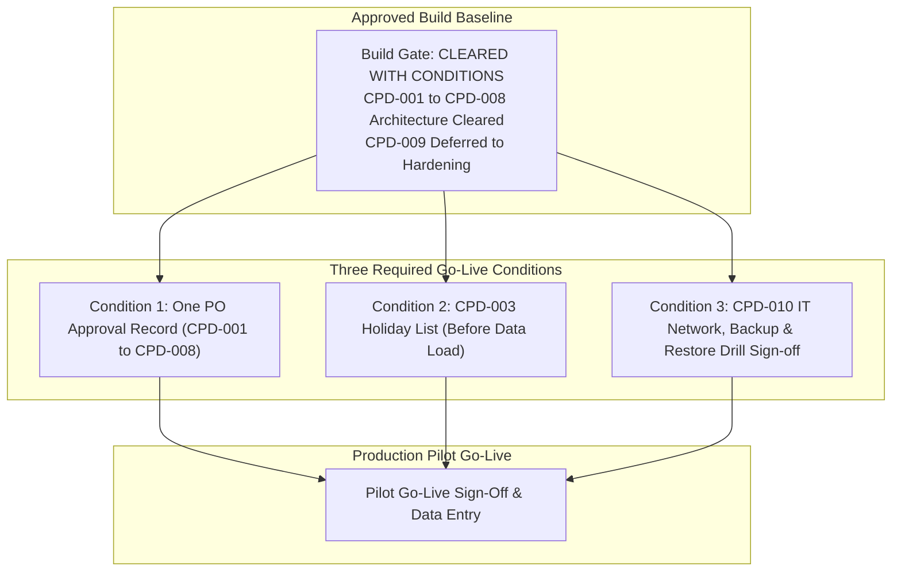

# Automotive Project & Resource Management System
## Go-Live Prerequisites & Operational Readiness Runbook — MVP Core Pilot

**Document Version:** 1.0  
**Status:** Operational Gate Document  
**Authoritative Sources:** PRD.md v1.0, docs/MVP-SCOPE.md, docs/CORE-PILOT-DECISIONS.md, docs/ARCHITECTURE.md  

---

## 1. Overview & Operational Governance

The technical architecture for the Core Pilot is formally approved (**CORE PILOT BUILD GATE: CLEARED WITH CONDITIONS**). Detailed material-change thresholds and mandatory-reason policies (CPD-009), corporate SSO, and advanced hardening features are deferred to MVP Operational Hardening.

Live deployment and data entry are subject to **three operational conditions before go-live**:



---

## 2. Outstanding Go-Live Gates Register (Tracked as PENDING)

| Gate ID | Prerequisite Name | Responsible Party | Current Status | Blocker Description & Next Step |
|---|---|---|---|---|
| **GATE-01** | **Consolidated PO Approval Record** | **Vivek (Product Owner)** | **Recorded in decision register; awaiting formal evidence reference** | Consolidated approval record for CPD-001 through CPD-008 recorded in decision register; awaiting formal evidence reference `[APPROVAL_EVIDENCE_REFERENCE]` before go-live. CPD-009 excluded (deferred to Operational Hardening). |
| **GATE-02** | **2026 Public Holiday List** | **Vivek (Product Owner)** | **PENDING** | Calendar calculation cannot determine accurate working days without official holiday dates. Awaiting completed intake table in `docs/PILOT-DECISION-APPROVAL-FORM.md` (`[HOLIDAY_LIST]`, `[HOLIDAY_LIST_SOURCE]`, `[HOLIDAY_LIST_APPROVER]`) before pilot data load. |
| **GATE-03** | **IT Network Access & SSO Waiver** | **IT Department / Vivek** | **PENDING** | Corporate IT confirmation of LAN/VPN network access and waiver permitting local Argon2id authentication for pilot. |
| **GATE-04** | **Designated Backup Destination & Restore Test** | **IT Infrastructure / Designated Operator** | **PENDING** | Designated off-host storage path and successful restore drill sign-off on recovery host with verified row counts before go-live. |

---

## 3. Pre-Flight Server Provisioning & Verification Checklist

Prior to launching Docker Compose containers on the designated pilot server, execute the following verification steps:

### 3.1 Host Infrastructure Verification
* [ ] **Operating System:** Linux host (Ubuntu 22.04 LTS / RHEL 9 recommended).
* [ ] **Container Engine:** Docker Engine v24+ and Docker Compose v2+ installed and running.
* [ ] **Network Exposure:** Host bound only to corporate LAN / VPN interfaces. Verified that public internet ingress is blocked.
* [ ] **Port Availability:** Ports `80` (HTTP redirect) and `443` (HTTPS) available and bound to Nginx. Verified port `5432` is not exposed to host network.
* [ ] **Storage Mount:** Verified Docker volume `postgres_data` has at least 50 GB free disk space.
* [ ] **Backup Mount:** Verified `/var/backups/db` mounts the designated separate network share / NAS (GATE-04).

### 3.2 Secrets & Configuration Bootstrapping
* [ ] File `.env` created in root deployment directory with permissions `chmod 400 .env` (read-only root).
* [ ] `DATABASE_URL` configured with strong random password.
* [ ] `SESSION_SECRET` configured with 64-byte random cryptographic key.
* [ ] `ADMIN_EMAIL` and `ADMIN_INITIAL_PASSWORD` set for initial System Admin seed.

### 3.3 Database Seeding Verification
* [ ] Run database migration scripts (`migrate up`).
* [ ] Verify seeded entities:
  * [ ] Product: `EMS ECU Development` (`PROD-EMS-ECU`) is created as the single top-level product.
  * [ ] Work-Area Tags: Exactly 14 tags created in `work_area_tags`.
  * [ ] Calendar: Organization time zone verified as `Asia/Kolkata`, standard hours = 8.00.
  * [ ] Public Holidays: Verified populated from approved 2026 holiday list (GATE-02: `[HOLIDAY_LIST]`).

---

## 4. Pre-Pilot Database Backup & Restore Drill Runbook (CPD-010, AG-6)

An untested backup is not a backup. In compliance with **CPD-010** and PRD acceptance criteria **AG-6**, a successful restore into a separate machine must be demonstrated and documented prior to pilot go-live.

### Step 1: Execute Production Backup Dump
On the pilot production host, trigger the automated backup script:
```bash
#!/bin/bash
set -e
TIMESTAMP=$(date +"%Y%m%d_%H%M%S")
BACKUP_DIR="/var/backups/db"
BACKUP_FILE="${BACKUP_DIR}/automotive_pilot_backup_${TIMESTAMP}.dump"

echo "Executing PostgreSQL custom-format dump..."
docker compose exec -T db pg_dump \
    -U postgres \
    -d automotive_pm_db \
    -F c \
    -b -v \
    -f "/tmp/backup.dump"

docker compose cp db:/tmp/backup.dump "${BACKUP_FILE}"
docker compose exec db rm /tmp/backup.dump

echo "Backup completed successfully: ${BACKUP_FILE}"
ls -lh "${BACKUP_FILE}"
```

### Step 2: Transfer Backup to Separate Recovery Host
Transfer the backup file to a designated secondary recovery machine or isolated test environment:
```bash
scp /var/backups/db/automotive_pilot_backup_*.dump operator@recovery-test-host:/tmp/
```

### Step 3: Execute Full Restore on Recovery Host
On the recovery host (running an isolated PostgreSQL 16 container):
```bash
#!/bin/bash
set -e
RECOVERY_FILE="/tmp/automotive_pilot_backup_*.dump"

echo "Creating clean recovery database..."
docker exec -i recovery_db dropdb -U postgres --if-exists automotive_recovery_db
docker exec -i recovery_db createdb -U postgres automotive_recovery_db

echo "Restoring database from backup file..."
docker exec -i recovery_db pg_restore \
    -U postgres \
    -d automotive_recovery_db \
    -v \
    ${RECOVERY_FILE}

echo "Database restore completed successfully."
```

### Step 4: Verification & Integrity Assertions
Run verification script on the recovery host comparing table row counts and schema integrity against the production source:
```sql
-- Verify key table row counts
SELECT 'products' AS entity, COUNT(*) FROM products
UNION ALL
SELECT 'work_area_tags', COUNT(*) FROM work_area_tags
UNION ALL
SELECT 'projects', COUNT(*) FROM projects
UNION ALL
SELECT 'activities', COUNT(*) FROM activities
UNION ALL
SELECT 'assignments', COUNT(*) FROM assignments
UNION ALL
SELECT 'leave_records', COUNT(*) FROM leave_records
UNION ALL
SELECT 'audit_log', COUNT(*) FROM audit_log;
```

---

## 5. Go/No-Go Sign-Off Form

This sign-off form must be formally executed prior to onboarding pilot engineering teams:

```
================================================================================
AUTOMOTIVE PROJECT & RESOURCE MANAGEMENT SYSTEM — PILOT GO-LIVE SIGN-OFF
================================================================================

GATE-01 — Consolidated Product Owner Approval Record:
[ ] Formal evidence reference recorded for CPD-001 through CPD-008
Reference ID: [APPROVAL_EVIDENCE_REFERENCE]  Approver: Vivek (Product Owner)

GATE-02 — 2026 Public Holiday Calendar List:
[ ] Received and validated official holiday list (Asia/Kolkata, Mon-Fri, 8h/day)
Date Received: _______________  Source: [HOLIDAY_LIST_SOURCE]  Verified by: [HOLIDAY_LIST_APPROVER]

GATE-03 — Corporate IT SSO Waiver:
[ ] Formally granted by Corporate IT Security for pilot duration
Confirmation Reference / Ticket ID: ______________________________________
IT Approver Name: ________________________________________________________

GATE-04 — Designated Off-Host Backup Storage & Pre-Pilot Restore Test Drill:
[ ] Network share / NAS confirmed separated from host machine
Storage Mount Path: ______________________________________________________
Storage Capacity Available: _____________________________________________
[ ] Pre-pilot restore test drill executed onto separate recovery machine
Drill Date: _______________  Operator Name: ______________________________
Row Counts Verified: [ ] PASS / [ ] FAIL
Target Environment Hostname / IP: ________________________________________

FINAL GO / NO-GO PILOT AUTHORIZATION:
[ ] GO — Approved to start pilot data entry and user onboarding
[ ] NO-GO — Outstanding operational blockers

Product Owner Signature: ________________________________  Date: ___________
IT / Operations Signature: ______________________________  Date: ___________
================================================================================
```

---

## 6. Out of Scope / Deferred Operational Items

* **Automated Spare-Host Failover / High-Availability Clustering:** (Deferred to Operational Hardening).
* **Automated WAL Shipping & Point-in-Time Recovery (PITR):** (Deferred to Operational Hardening; RPO commit is daily backup in pilot).
* **Corporate SSO (AD / LDAP / OIDC) Deployment:** (Deferred to Release 2).
* **Automated Disaster Recovery Drill Pipelines:** (Deferred to Operational Hardening).
