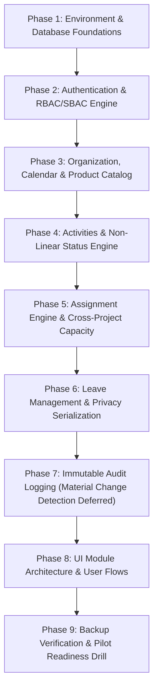

# Automotive Project & Resource Management System
## Engineering Implementation Plan — MVP Core Pilot

**Document Version:** 1.0
**Status:** Approved Technical Design
**Authoritative Sources:** PRD.md v1.0, docs/MVP-SCOPE.md, docs/CORE-PILOT-DECISIONS.md, docs/ARCHITECTURE.md

---

## 1. Engineering Strategy & Phased Execution

The MVP Core Pilot implementation is organized into sequential vertical engineering phases. Each phase culminates in fully tested, working functionality with verifiable automated unit and integration tests.

### Phasing Principles
1. **Vertical Slice Order:** Build the persistent foundation → identity & permissions → product/project core → activity state machine → cross-project capacity engine → leave privacy → audit governance → UI modules.
2. **Deterministic Governance:** Business rules from **CPD-001 through CPD-010** must be verified through automated tests before proceeding to subsequent phases.
3. **No Premature Optimization:** Focus exclusively on the single-server pilot workload (100 concurrent users, single EMS ECU Development product hierarchy).

---

## 2. Phase-by-Phase Implementation Roadmap

---

### Phase 1: Environment & Database Scaffolding
* **Objectives:** Provision the local development and container runtime.
* **Deliverables:**
  * `docker-compose.yml` specifying Nginx, backend service, and PostgreSQL 16.
  * Versioned database migration framework (e.g., node-pg-migrate or Flyway).
  * Baseline migration files creating tables, primary/foreign keys, indexes, and triggers as specified in `docs/DATA_MODEL.md`.
  * Automated migration runner and rollback scripts.
* **Traceability:** CPD-010, Architecture § 5.

---

### Phase 2: Authentication & Access Control Core
* **Objectives:** Implement secure local credentials and authorization middleware.
* **Deliverables:**
  * Argon2id hashing utility with OS CSPRNG salting.
  * Session storage and secure cookie handling (`HttpOnly; Secure; SameSite=Strict`).
  * First-run admin bootstrapping service reading protected `.env` credentials.
  * RBAC & SBAC middleware evaluating the 5 pilot roles: `System Admin`, `Project Manager`, `Team Lead`, `Team Member`, `Resource Manager`.
  * Unit tests validating login rate limiting, failed attempt lockout, and scope enforcement.
* **Traceability:** CPD-008, CPD-010, PRD Security.

---

### Phase 3: Organization, Calendar & Product Catalog
* **Objectives:** Establish organization baseline and seed the pilot product structure.
* **Deliverables:**
  * Seed migration populating:
    * Single top-level product: **EMS ECU Development** (`PROD-EMS-ECU`).
    * 14 configurable Project Work-Area Tags (`work_area_tags`).
    * Default calendar settings: 8 hours/day, Mon–Fri, `Asia/Kolkata` time zone.
  * Teams, members, and working pattern configuration endpoints.
  * Project creation and multi-select Work-Area Tag linking via junction table.
  * Authorization guard ensuring only `SYSTEM_ADMIN` can create products.
* **Traceability:** CPD-001, CPD-003, CPD-008, BR-001.

---

### Phase 4: Activities & Non-Linear Status Workflow
* **Objectives:** Implement authoritative activities, sub-activity nesting, and status transitions.
* **Deliverables:**
  * Activity CRUD endpoints with readable code sequence generator (`PRJ-XXXX`).
  * Database trigger enforcing maximum sub-activity nesting depth of 1 level (Activity → Sub-activity; depth = 2).
  * State machine service enforcing the non-linear transition matrix:
    * Terminal states (`DONE`, `CANCELLED`) reachable from any active status.
    * Reversible transition `BLOCKED ⇄ IN_PROGRESS` without administrative intervention.
    * Terminal state reopening restricted to `SYSTEM_ADMIN` with mandatory justification.
  * Atomic cancellation cascade: releases future assigned load and preserves historical audit records.
  * *Schema reservation:* Placeholder `activity_dependencies` table created (logic deferred).
* **Traceability:** CPD-007, BR-002, BR-004, BR-008.

---

### Phase 5: Assignment Engine & Cross-Project Capacity
* **Objectives:** Implement assignment scheduling and real-time cross-project overload protection.
* **Deliverables:**
  * Assignment creation endpoint distributing effort evenly across working days in hours.
  * Deterministic cross-project capacity aggregation SQL query joining all active projects (excluding `ARCHIVED` and `CANCELLED`).
  * Real-time conflict evaluator:
    * 90% planned weekly utilization returns soft warning response.
    * 100% planned weekly utilization blocks assignment creation (`409 Conflict`).
  * Override endpoint allowing System Admin or assigned Project Manager to override hard conflicts with mandatory written justification (min 10 chars).
  * Cross-project workload heatmap API and unassigned demand backlog query.
* **Traceability:** CPD-002, CPD-004, CPD-005, CPD-008, FR-CAP-001–007.

---

### Phase 6: Leave Management & Server-Side Privacy Serialization
* **Objectives:** Integrate leave into net capacity calculations and enforce employee privacy.
* **Deliverables:**
  * Leave request submission and approval workflow (Team Lead for team, Resource Manager in scope, System Admin for all).
  * Capacity deduction hook: only `APPROVED` leave deducts hours; `PENDING` leave creates soft warning on overlapping assignments.
  * Server-side privacy serializer: strips leave reason and type for Project Managers and peer members; exposes type only to Team Leads; exposes full record to Resource Managers and Admins.
* **Traceability:** CPD-006, FR-RES-004, PRD Security.

---

### Phase 7: Material Change Detection & Immutable Audit Trail (Superseded for Core Pilot)
* **Status:** Superseded for Core Pilot; Material-Change Threshold Detection Deferred to Operational Hardening (CPD-009).
* **Governance Notice:** Per Product Owner decision on 2026-10-11, CPD-009 material-change threshold enforcement (shift of >= 3 working days, estimate change of >= 20 percent, ordinary-edit mandatory reason prompts, and configurable material-change threshold interceptors) is deferred to Operational Hardening and is excluded from Core Pilot scope.
* **Core Pilot Audit Baseline:**
  * Core Pilot retains append-only `audit_log` records and mandatory justifications for already-approved actions:
    * CPD-007 terminal administrative overrides (entering `DONE` or `CANCELLED`, revoking `DONE → CANCELLED`, reopening `DONE` or `CANCELLED` with trimmed justification >= 10 chars).
    * CPD-004 capacity hard-block overrides (100% utilization override with trimmed justification >= 10 chars).
    * CPD-006 leave management workflow actions and privacy controls.
  * Ordinary activity field updates (dates, estimates, assignees, priorities) are logged without triggering material-change prompts or blocking saves in Core Pilot.
* **Traceability:** CPD-007, CPD-004, CPD-006, CPD-009 (Deferred).

---

### Phase 8: UI Module Architecture & Functional User Flows
*(Functional layout specifications only — no UI code or wireframes are generated in this phase)*

* **Module 1: Navigation & Context Switcher:**
  * Top bar displaying current user role, active scope, and time zone indicator (`Asia/Kolkata`).
* **Module 2: Project Activity Workspace:**
  * Hierarchical tree view showing Phase → Activity → Sub-activity with status badges, owners, and remaining effort hours.
* **Module 3: Cross-Project Workload Heatmap:**
  * Matrix grid showing engineers on the Y-axis and calendar weeks on the X-axis.
  * Cells colored Green (<90%), Amber (90–99.99% warning), and Red (>=100% hard block), aggregating load from all active pilot projects.
* **Module 4: Assignment & Conflict Modal:**
  * Modal showing planned hours distribution and real-time utilization check. Displays conflict override dialog if 100% threshold is breached.
* **Module 5: Leave Management Board:**
  * Calendar board for leave requests with privacy-sanitized tooltips.

---

### Phase 9: Backup Verification & Pilot Readiness Drill
* **Objectives:** Fulfill go-live operational requirements.
* **Deliverables:**
  * Automated daily `pg_dump` script configured to store backups off the application server.
  * Execution and documented sign-off of the pre-pilot restore drill into a separate test environment.
  * Verification of the 4 go-live gates with Vivek and IT.
* **Traceability:** CPD-010, AG-6, NFR Availability.

---

## 3. Pending Operational Go-Live Gates

The following items are preserved as **PENDING** and must be resolved before live pilot rollout:
1. **2026 Company / Public Holiday List:** Vivek to provide the list before Phase 3 seed scripts are executed.
2. **IT SSO Waiver Confirmation:** Formal IT waiver for local login before Phase 2 is deployed to production host.
3. **Designated Backup Destination:** IT confirmation of off-host network share / NAS mount before Phase 9.
4. **Restore Drill Sign-Off:** Execution and documented record of restore drill on separate machine before Phase 9 go-live.

---

## 4. Out of Scope / Deferred Items (MVP Operational Hardening)

* **Material-Change Threshold Detection & Interceptors:** (CPD-009 deferred to Operational Hardening; date shifts >= 3 days, estimate changes >= 20%, and ordinary-edit reason prompts are excluded from Core Pilot).
* **Finish-to-Start Active Dependency Engine:** (Deferred to Operational Hardening; schema reserved).
* **Predecessor Cancellation Active Review Flag UI:** (Deferred to Operational Hardening).
* **Corporate SSO / Active Directory Integration:** (Deferred to Release 2).
* **Interactive Gantt Chart Component:** (Deferred to Operational Hardening).
* **Excel / CSV Bulk Import Wizard:** (Deferred to Operational Hardening).
* **Continuous WAL Archiving / Point-In-Time Recovery:** (Deferred to Operational Hardening).
