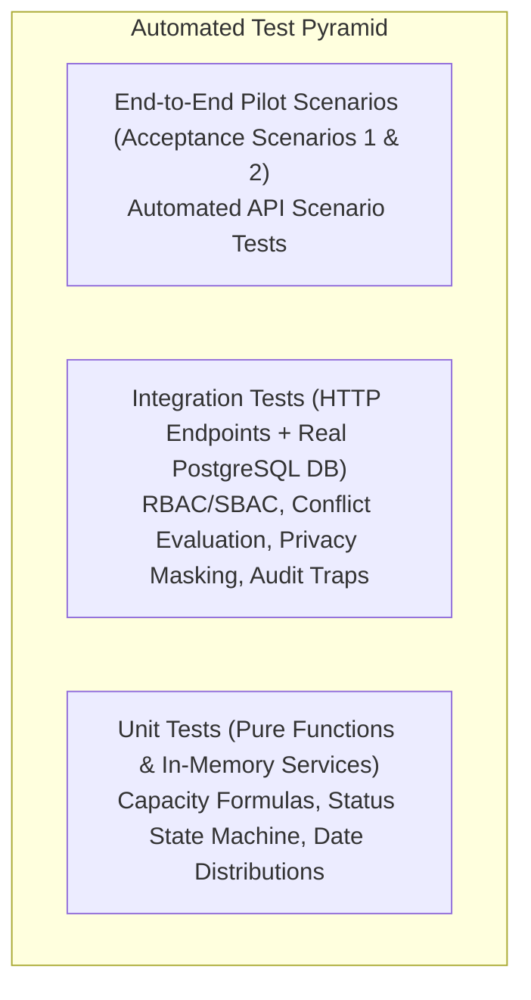

# Automotive Project & Resource Management System
## Quality Assurance & Test Strategy Specification — MVP Core Pilot

**Document Version:** 1.0  
**Status:** Approved Technical Design  
**Authoritative Sources:** PRD.md v1.0, docs/MVP-SCOPE.md, docs/CORE-PILOT-DECISIONS.md, docs/ARCHITECTURE.md  

---

## 1. Testing Philosophy & Test Pyramid

Quality assurance for the Automotive Project and Resource Management System centers on automated verification of deterministic capacity mathematics, state machine integrity, privacy serialization, and immutable audit trails.

### Core Testing Standards
1. **Isolated Database Harness:** Integration tests run against an ephemeral or isolated PostgreSQL database instance where each test suite executes within an isolated transaction or isolated schema.
2. **Zero False Positives:** Capacity calculation tests execute against explicit calendar dates with deterministic holiday tables.
3. **Security Invariant Verification:** Authorization tests must assert negative cases (`403 Forbidden` / `401 Unauthorized`) for every restricted action.

---

## 2. Test Cases for Approved Business Rules (CPD-001 through CPD-010)

### 2.1 Product Hierarchy & Work-Area Tags (CPD-001, BR-001)

* **TC-CAT-001: Project must belong to exactly one Product**
  * *Setup:* Attempt to insert a project with `product_id = NULL` or an invalid UUID.
  * *Expected Result:* Database constraint violation (`FOREIGN KEY CONSTRAINT` or `NOT NULL`), API returns `400 Bad Request`.
* **TC-CAT-002: Multi-select Work-Area Tags on single project**
  * *Setup:* Create project and associate 4 tags (`Customer Vehicle Program`, `Base Software`, `Application Software`, `Validation`).
  * *Expected Result:* Successfully saves in `project_work_area_tags` junction table. No new rows are created in `products` table.
* **TC-CAT-003: Sub-products are blocked**
  * *Setup:* Attempt to create a child product under `PROD-EMS-ECU`.
  * *Expected Result:* API returns `400 Bad Request` (hierarchy is flat at Product level).

---

### 2.2 Estimate & Capacity Unit (CPD-002, BR-004)

* **TC-EST-001: Mandatory hours unit for activities**
  * *Setup:* Submit activity without an estimate or with non-numeric value.
  * *Expected Result:* Request rejected (`400 Bad Request`).
* **TC-EST-002: Story points do not alter capacity calculations**
  * *Setup:* Create activity with `original_estimate_hours = 40.00` and notes containing `story_points: 8`.
  * *Expected Result:* Capacity engine schedules exactly 40.00 hours. The story points value has zero mathematical impact on utilization.

---

### 2.3 Organization Calendar & Time Zone (CPD-003, BR-014)

* **TC-CAL-001: Standard 40h working week base capacity**
  * *Setup:* Query base capacity for an engineer with zero buffer and no leave for standard week Mon–Fri.
  * *Expected Result:* Base capacity = `5 days * 8 hours = 40.00 hours`.
* **TC-CAL-002: Time zone boundary consistency**
  * *Setup:* Schedule milestone for `2026-11-15` in `Asia/Kolkata`.
  * *Expected Result:* Date stored in UTC corresponds to the exact start of day in `Asia/Kolkata` (+05:30); no midnight-rollover truncation.

---

### 2.4 Capacity Rules & Thresholds (CPD-004, FR-CAP-004–007)

* **TC-CAP-001: 90% planned utilization triggers soft warning**
  * *Setup:* Assign engineer 36.00 hours in a 40.00h net capacity week (90.00% utilization).
  * *Expected Result:* Assignment is saved (`201 Created`), response includes `X-Warning-Capacity: SOFT_WARNING_90_PERCENT`.
* **TC-CAP-002: 100% planned utilization blocks assignment (Hard Block)**
  * *Setup:* Assign engineer 40.01 hours in a 40.00h net capacity week (100.025% utilization).
  * *Expected Result:* API returns `409 Conflict` with error code `CAPACITY_HARD_CONFLICT`. Assignment is not saved.
* **TC-CAP-003: Authorized override with recorded reason**
  * *Setup:* Assigned Project Manager submits override endpoint for 44.00h assignment with reason `"Critical release gate"` (21 chars).
  * *Expected Result:* Assignment saved (`201 Created`). Row written to `conflict_overrides` and `audit_log`.
* **TC-CAP-004: Override rejected without valid reason length**
  * *Setup:* PM submits override with reason `"urgent"` (6 chars < min 10 chars).
  * *Expected Result:* API returns `400 Bad Request` with error code `REASON_TOO_SHORT`.
* **TC-CAP-005: Zero net capacity week with assigned load**
  * *Setup:* Engineer on approved leave for full week (net capacity = 0h). Planner attempts to assign 8h task.
  * *Expected Result:* API returns `409 Conflict` (Hard Block).

---

### 2.5 Cross-Project Load Aggregation (CPD-005, PRD Acceptance Scenario 1)

* **TC-AGG-001: Cross-project overload detection (PRD Acceptance Scenario 1)**
  * *Setup:* Engineer Ananya is assigned 24 hours on Project A (`PRJ-EMS-GEN3`). A planner opens Project B (`PRJ-CALIB-MY27`) and attempts to assign Ananya 20 hours in the same week.
  * *Expected Result:* Total planned hours = `24 + 20 = 44 hours` against 40h capacity (110% utilization). System rejects assignment on Project B with `409 Conflict`.
* **TC-AGG-002: Archived and cancelled projects excluded from load**
  * *Setup:* Engineer has 40 hours on Project C whose status is `CANCELLED`. Planner assigns 40 hours on Project A.
  * *Expected Result:* Cancelled project load is ignored (0h). Project A assignment saves successfully at 100% (or warns at 90%).
* **TC-AGG-003: Cross-project unassigned demand query**
  * *Setup:* Create unassigned `READY_FOR_PLANNING` activities across Project A and Project B.
  * *Expected Result:* `GET /api/v1/capacity/unassigned` returns all unassigned tasks across both projects without filtering by user project membership.

---

### 2.6 Leave Rules & Privacy Masking (CPD-006, PRD Acceptance Scenario 2)

* **TC-LEV-001: Pending leave does not deduct capacity**
  * *Setup:* Engineer submits leave for Mon–Fri (status = `PENDING`).
  * *Expected Result:* Net capacity remains 40.00 hours. Assignments overlapping the dates display a soft warning indicator.
* **TC-LEV-002: Approved leave immediately reduces net capacity**
  * *Setup:* Team Lead approves leave for Mon–Tue (16 hours).
  * *Expected Result:* Net capacity immediately updates to `40.00 - 16.00 = 24.00 hours`.
* **TC-LEV-003: Leave privacy serialization for Project Manager & Peer Member**
  * *Setup:* Engineer submits medical leave with `leave_type = SICK` and `leave_reason = "Post-surgical recovery"`. Project Manager queries `GET /api/v1/leave`.
  * *Expected Result:* Response contains `leave_type: null`, `leave_reason: null`. Only `start_date`, `end_date`, and duration are returned.
* **TC-LEV-004: Leave privacy serialization for Team Lead**
  * *Setup:* Team Lead queries `GET /api/v1/leave` for own team member.
  * *Expected Result:* Response contains `leave_type: "SICK"`, but `leave_reason: null`.
* **TC-LEV-005: Full leave record for Resource Manager & Admin**
  * *Setup:* Resource Manager queries `GET /api/v1/leave`.
  * *Expected Result:* Full object returned including `leave_reason: "Post-surgical recovery"`.

---

### 2.7 Activity Workflow & Non-Linear Status Transitions (CPD-007)

* **TC-ACT-001: Sub-activity depth restriction (Max 1 level)**
  * *Setup:* Create Activity A. Create Sub-activity B with parent = A (succeeds). Attempt to create Sub-activity C with parent = B.
  * *Expected Result:* Database trigger / API rejects creation with `400 Bad Request` (`"Sub-activity nesting depth cannot exceed 1 level"`).
* **TC-ACT-002: Non-linear terminal transition to Done from any active state**
  * *Setup:* Transition activities in `DRAFT`, `READY_FOR_PLANNING`, `PLANNED`, `IN_PROGRESS`, and `BLOCKED` directly to `DONE` with valid reason.
  * *Expected Result:* All transitions succeed (`200 OK`).
* **TC-ACT-003: Non-linear terminal transition to Cancelled from any active state**
  * *Setup:* Transition activities in `DRAFT`, `PLANNED`, `IN_PROGRESS`, `BLOCKED`, and `DONE` to `CANCELLED` with valid reason.
  * *Expected Result:* All transitions succeed (`200 OK`). Future assigned workload is zeroed immediately.
* **TC-ACT-004: Bidirectional reversible transition `BLOCKED ⇄ IN_PROGRESS`**
  * *Setup:* Assignee sets `IN_PROGRESS → BLOCKED`. Assignee subsequently sets `BLOCKED → IN_PROGRESS`.
  * *Expected Result:* Both succeed without requiring administrative privileges.
* **TC-ACT-005: Reopening terminal state blocked for non-Admin**
  * *Setup:* Project Manager attempts `DONE → IN_PROGRESS` or `CANCELLED → IN_PROGRESS`.
  * *Expected Result:* API returns `403 Forbidden` (`"Reopening closed activities requires System Admin authority"`).
* **TC-ACT-006: Reopening terminal state succeeds for System Admin with reason**
  * *Setup:* System Admin executes `DONE → IN_PROGRESS` with reason `"Scope reopened per OEM change request"` (36 chars).
  * *Expected Result:* Transition succeeds (`200 OK`), audit log recorded.

---

### 2.8 Roles & Scope Authorization (CPD-008)

* **TC-SEC-001: Project Manager cannot create Products**
  * *Setup:* User with `PROJECT_MANAGER` role calls `POST /api/v1/products`.
  * *Expected Result:* API returns `403 Forbidden`.
* **TC-SEC-002: Project Manager scoped assignment enforcement**
  * *Setup:* Project Manager assigned to Project A attempts to create an activity or assignment in Project B.
  * *Expected Result:* API returns `403 Forbidden` (`"User is not authorized for target project scope"`).
* **TC-SEC-003: User with multiple roles executes compound permissions**
  * *Setup:* User has both `TEAM_LEAD` and `PROJECT_MANAGER` roles.
  * *Expected Result:* User can assign members on their project AND approve leave for their team members.

---

### 2.9 Material Change Audit Enforcement (CPD-009)

* **TC-AUD-001: Date change: shift of >= 3 working days requires reason**
  * *Setup:* Move activity due date by 3 or more working days without `change_reason`.
  * *Expected Result:* API returns `400 Bad Request` (`"Material change requires a justification reason of at least 10 characters"`).
* **TC-AUD-002: Date shift < 3 working days saves silently**
  * *Setup:* Move activity due date by 2 working days without `change_reason`.
  * *Expected Result:* API returns `200 OK`. Audit log row is written silently with null reason.
* **TC-AUD-003: Estimate change: change of >= 20 percent requires reason**
  * *Setup:* Change estimate from 40.00h to 50.00h (+25%) without reason.
  * *Expected Result:* API returns `400 Bad Request`. When submitted with reason >= 10 chars, request succeeds.

---

## 3. Out of Scope / Deferred Test Areas (Operational Hardening)

* **Finish-to-Start Automated Dependency Shifting:** Testing automatic date ripple upon predecessor delay is deferred to Operational Hardening.
* **Predecessor Cancellation Active Review Flag Engine:** Testing dependency review warnings is deferred to Operational Hardening.
* **Corporate SSO / Active Directory Integration Tests:** Deferred to Release 2.
* **Gantt Drag-and-Drop Visual Test Automation:** Deferred to Operational Hardening.
* **Load Testing at 10,000+ Concurrent Activities:** Deferred to post-pilot hardening.
